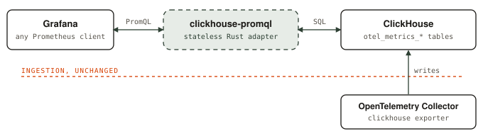

# clickhouse-promql-otel-adapter

A Prometheus-compatible query API over the metrics tables the OpenTelemetry
Collector writes to ClickHouse. Point Grafana's standard Prometheus data source
at it and query your OTel metrics with PromQL.

## Why

If your metrics already land in ClickHouse through the Collector's ClickHouse
exporter, you shouldn't need a second metrics store (Prometheus, Thanos, Mimir)
just to get PromQL. This adapter reads the existing tables as they are. You don't
change the schema, add a second ingestion path or make a copy of the data.

### Why PromQL instead of raw ClickHouse SQL?

- **Every tool already speaks it.** Grafana dashboards, Explore, alerting and
  community dashboards all expect a Prometheus data source.
- **Counters are hard in SQL.** `rate()`, `increase()` and
  `histogram_quantile()` need counter-reset handling, sliding windows,
  extrapolation and lookback. In SQL, every panel repeats that logic, and each
  copy can get it slightly wrong.
- **The OTel schema is awkward to query by hand.** Labels live in `Map` columns,
  each metric type has its own table, and series identity is spread across
  resource attributes, scope and point attributes.
- **Queries stay short.** One line of PromQL replaces a page of CTEs and window
  functions.
- **The queries are portable.** The same PromQL runs against Prometheus, Thanos or
  Mimir if you ever move.

**Before and after: requests per second, by service**

```promql
sum by (service_name) (rate(http_server_requests_total[5m]))
```

```sql
WITH deltas AS (
  SELECT
    ServiceName,
    TimeUnix,
    Value,
    Value - lagInFrame(Value, 1, Value) OVER w AS delta
  FROM otel_metrics_sum
  WHERE MetricName = 'http.server.requests'
    AND TimeUnix >= now() - INTERVAL 1 HOUR
  WINDOW w AS (
    PARTITION BY cityHash64(ResourceAttributes, ScopeName, Attributes)
    ORDER BY TimeUnix
    ROWS BETWEEN 1 PRECEDING AND CURRENT ROW
  )
)
SELECT
  toStartOfMinute(TimeUnix) AS t,
  ServiceName,
  sum(if(delta < 0, Value, delta)) / 60 AS rps -- a negative delta means the counter reset
FROM deltas
GROUP BY t, ServiceName
ORDER BY t
```

That SQL is already longer, and it's **still wrong** in ways the PromQL handles:
it uses fixed one-minute buckets instead of a sliding five-minute window, it
doesn't extrapolate to the window edges, and it breaks on delta-temporality
counters. It also doesn't scale `rps` when samples arrive more often than once
a minute.

The examples below are simplified and still less correct than their PromQL.

<details>
<summary><b>p99 latency from a histogram</b></summary>

```promql
histogram_quantile(0.99,
  sum by (service_name, le) (rate(http_server_request_duration_seconds_bucket[5m])))
```

```sql
WITH deltas AS (
  SELECT
    ServiceName,
    toStartOfMinute(TimeUnix) AS t,
    ExplicitBounds,
    BucketCounts,
    lagInFrame(BucketCounts, 1, BucketCounts) OVER w AS prev
  FROM otel_metrics_histogram
  WHERE MetricName = 'http.server.request.duration'
    AND AggregationTemporality = 2 -- cumulative only; delta needs another branch
    AND TimeUnix >= now() - INTERVAL 1 HOUR
  WINDOW w AS (
    PARTITION BY cityHash64(ResourceAttributes, ScopeName, Attributes)
    ORDER BY TimeUnix
    ROWS BETWEEN 1 PRECEDING AND CURRENT ROW
  )
),
per_step AS (
  SELECT
    t,
    ServiceName,
    any(ExplicitBounds) AS bounds, -- assumes every series uses the same buckets
    sumForEach(arrayMap((c, p) -> if(c >= p, c - p, c), BucketCounts, prev)) AS counts
  FROM deltas
  GROUP BY t, ServiceName
),
ranked AS (
  SELECT t, ServiceName, bounds, counts,
         arrayCumSum(counts) AS cum,
         arraySum(counts) * 0.99 AS rank
  FROM per_step
)
SELECT
  t,
  ServiceName,
  arrayFirstIndex(c -> c >= rank, cum) AS i,
  if(i = 1, 0, bounds[i - 1]) AS lower,
  if(i > length(bounds), bounds[length(bounds)], bounds[i]) AS upper,
  if(i = 1, 0, cum[i - 1]) AS below,
  lower + (upper - lower) * (rank - below) / counts[i] AS p99
FROM ranked
ORDER BY t
```

Still missing: mixed bucket layouts, the `+Inf` bucket rule, exponential
histograms, sliding windows and whole-histogram reset detection.

</details>

<details>
<summary><b>Multi-window SLO burn-rate alert</b></summary>

```promql
(
  sum(rate(http_server_requests_total{http_response_status_code=~"5.."}[1h]))
    / sum(rate(http_server_requests_total[1h])) > 14.4 * 0.001
)
and
(
  sum(rate(http_server_requests_total{http_response_status_code=~"5.."}[5m]))
    / sum(rate(http_server_requests_total[5m])) > 14.4 * 0.001
)
```

```sql
WITH deltas AS (
  SELECT
    TimeUnix,
    Value,
    startsWith(Attributes['http.response.status_code'], '5') AS is_error,
    Value - lagInFrame(Value, 1, Value) OVER w AS raw_delta
  FROM otel_metrics_sum
  WHERE MetricName = 'http.server.requests'
    AND TimeUnix >= now() - INTERVAL 2 HOUR
  WINDOW w AS (
    PARTITION BY cityHash64(ResourceAttributes, ScopeName, Attributes)
    ORDER BY TimeUnix
    ROWS BETWEEN 1 PRECEDING AND CURRENT ROW
  )
),
per_minute AS (
  SELECT
    toStartOfMinute(TimeUnix) AS t,
    sumIf(if(raw_delta < 0, Value, raw_delta), is_error) AS errors,
    sum(if(raw_delta < 0, Value, raw_delta)) AS total
  FROM deltas
  GROUP BY t
),
windows AS (
  SELECT
    t,
    sum(errors) OVER (ORDER BY t RANGE BETWEEN 3540 PRECEDING AND CURRENT ROW) AS errors_1h,
    sum(total)  OVER (ORDER BY t RANGE BETWEEN 3540 PRECEDING AND CURRENT ROW) AS total_1h,
    sum(errors) OVER (ORDER BY t RANGE BETWEEN 240 PRECEDING AND CURRENT ROW) AS errors_5m,
    sum(total)  OVER (ORDER BY t RANGE BETWEEN 240 PRECEDING AND CURRENT ROW) AS total_5m
  FROM per_minute
)
SELECT t
FROM windows
WHERE t >= now() - INTERVAL 1 HOUR
  AND errors_1h / total_1h > 14.4 * 0.001
  AND errors_5m / total_5m > 14.4 * 0.001
ORDER BY t
```

Still missing: extrapolation, delta temporality and the lookback rules. The
second hour of data is scanned only to warm up the one-hour window.

</details>

<details>
<summary><b>Top 5 memory growth compared with yesterday</b></summary>

```promql
topk(5, process_memory_usage_bytes - process_memory_usage_bytes offset 1d)
```

```sql
WITH
  now() AS ts,
  latest AS ( -- newest sample per series inside the five-minute lookback window
    SELECT ResourceAttributes, Attributes, argMax(Value, TimeUnix) AS v
    FROM otel_metrics_gauge
    WHERE MetricName = 'process.memory.usage'
      AND TimeUnix BETWEEN ts - INTERVAL 5 MINUTE AND ts
    GROUP BY ResourceAttributes, Attributes
  ),
  day_ago AS (
    SELECT ResourceAttributes, Attributes, argMax(Value, TimeUnix) AS v
    FROM otel_metrics_gauge
    WHERE MetricName = 'process.memory.usage'
      AND TimeUnix BETWEEN ts - INTERVAL 1 DAY - INTERVAL 5 MINUTE
                       AND ts - INTERVAL 1 DAY
    GROUP BY ResourceAttributes, Attributes
  )
SELECT l.ResourceAttributes, l.Attributes, l.v - d.v AS growth
FROM latest AS l
INNER JOIN day_ago AS d USING (ResourceAttributes, Attributes)
ORDER BY growth DESC
LIMIT 5
```

That returns a single point in time. To graph it, every CTE needs a time-step
dimension. In PromQL, you switch the query to a range query.

</details>

## Architecture

<p align="center">
  <picture>
    <source media="(prefers-color-scheme: dark)" srcset="./.github/media/architecture-dark.svg">
    
  </picture>
</p>

- The **Collector** owns ingestion and creates the five default
  `otel_metrics_*` tables (gauge, sum, histogram, exponential histogram,
  summary). The adapter never writes to them.
- The **adapter** is a single Rust binary. It parses PromQL, pushes series and
  time-range selection down to ClickHouse as SQL, and runs evaluation in its own
  engine (rates, aggregations, histograms, Thanos-style replica dedup).
  OTel metric and attribute names are converted to Prometheus names the same way
  `prometheus/otlptranslator` converts them.
- It's **stateless**: no cache and no local storage. You can run as many replicas
  as you like.

It is tested against the upstream Prometheus PromQL test corpus (21k+ executions)
and 1k+ HTTP reference cases. See [compatibility](docs/compatibility.md). The
default exporter schema loses subsecond timestamps and some histogram and
metadata fields, so results aren't lossless in every case. See
[schema findings](docs/schema-findings.md).

## Quickstart

You need a ClickHouse database that the Collector's ClickHouse exporter already
writes to.

**Docker:**

```sh
docker run --rm -p 9091:9091 \
  -e CLICKHOUSE_URL=http://clickhouse:8123 \
  -e CLICKHOUSE_DATABASE=otel \
  -e CLICKHOUSE_USER=default \
  -e CLICKHOUSE_PASSWORD=... \
  ghcr.io/rivet-dev/clickhouse-promql-otel-adapter:latest
```

**From source:**

```sh
cargo build --locked --release
CLICKHOUSE_URL=http://127.0.0.1:8123 CLICKHOUSE_PASSWORD=... \
  ./target/release/clickhouse-promql --host 0.0.0.0
```

Then in Grafana, add a **Prometheus** data source with the URL
`http://<adapter-host>:9091`.

To see the whole pipeline running locally (metric generator, Collector,
ClickHouse, adapter and Grafana), follow the [demo](demo/README.md).

## Reference

### Configuration

| Flag | Env | Default | Description |
|---|---|---|---|
| `--host` | | `127.0.0.1` | Bind address (the container image uses `0.0.0.0`) |
| `--port` | | `9091` | HTTP port |
| `--clickhouse-url` | `CLICKHOUSE_URL` | `http://127.0.0.1:18123` | ClickHouse HTTP endpoint |
| `--database` | `CLICKHOUSE_DATABASE` | `otel` | Database containing the `otel_metrics_*` tables |
| `--username` | `CLICKHOUSE_USER` | `default` | ClickHouse user |
| `--password` | `CLICKHOUSE_PASSWORD` | empty | ClickHouse password |
| `--replica-label <name>` | | none | Label that identifies HA replicas for Thanos dedup. Repeat the flag to set several. |
| `--thanos-default-step <secs>` | | off | Accept range queries without `step`, using Thanos defaults (usually `60`). By default `step` is required, as in Prometheus. |
| | `RUST_LOG` | | Log filter, for example `info` or `clickhouse_promql=debug` |

### HTTP endpoints

- `/api/v1/*`: Prometheus query API (`query`, `query_range`, `series`, `labels`,
  `label/<name>/values`, `metadata`, `query_exemplars`, `format_query`,
  `parse_query`, `status/buildinfo`), plus Thanos query parameters (`dedup`,
  `replicaLabels[]`, `partial_response`, `max_source_resolution`, `shard_info`
  and others).
- `/-/healthy` checks liveness. `/-/ready` checks readiness and makes a real
  ClickHouse request.
- `/metrics` exposes adapter build info.

Not implemented: rules and alerts (use Grafana-managed alerting), remote
read/write, ingestion, TSDB admin and the Thanos StoreAPI. These routes return 404.

The adapter has **no built-in auth or TLS**. Put it behind your own network
controls or a reverse proxy.

Full details, including default resource limits and error codes, are in the
[API contract](docs/api-contract.md).

### Development

```sh
docker compose up -d --wait        # test ClickHouse on 127.0.0.1:18123
cargo test --locked
python3 scripts/conformance.py     # Prometheus corpus
```

Snapshot and reference regeneration (requires Go) is described in the
[evaluator](docs/evaluator-report.md) and [storage](docs/storage-report.md)
reports. Pushing a `vX.Y.Z` tag that matches `Cargo.toml` publishes Linux
amd64/arm64 binaries (glibc 2.39+) and a multi-arch image to GHCR.

## Maintenance

We built this for internal use at [Rivet](https://rivet.dev). We appreciate PRs,
but we probably won't merge them. If you maintain a serious fork, open an issue
and we'll list it here so others who find this project can use it.

**Forks:** none yet.

## License

[Apache 2.0](LICENSE). See [NOTICE](NOTICE) for third-party attributions
(Prometheus, Thanos, Greptime `promql-parser`, otlptranslator).
