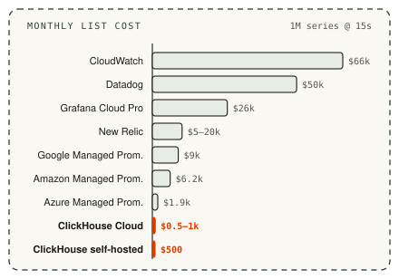

# clickhouse-promql-otel-adapter

**PromQL for OpenTelemetry metrics in ClickHouse.** Point Grafana's Prometheus data source at it.

<p align="center">
  <picture>
    <source media="(prefers-color-scheme: dark)" srcset="./.github/media/architecture-dark.svg">
    
  </picture>
</p>

- **Reads the Collector's exporter tables as-is**: no second store, schema change or data copy
- **Stateless Rust binary**: Prometheus + Thanos query API, scale replicas freely
- **Tested**: 21,442 upstream PromQL executions + 1,016 HTTP reference cases ([compatibility](docs/compatibility.md))
- **Caveat**: default schema drops subsecond timestamps and some histogram fields ([details](docs/schema-findings.md))

## Goals

- **Vanilla OTel → ClickHouse**: stock Collector exporter, no extra observability layer
- **Full PromQL**: works with Grafana's built-in Prometheus data source
- **Stateless**: translates PromQL into ClickHouse queries; no storage, cache or ingestion of its own

## Why ClickHouse

- **Cost**: ~$500/mo for 1M series vs $2k–66k on managed platforms (below)
- **S3 tiered storage**: keep hot data on disk, age the rest to object storage
- **Scale**: columnar compression, sharding and replication for trillion-row tables
- **High cardinality**: no per-series memory index or per-series billing; cost tracks rows stored
- **Complex analytics**: drop to SQL for what PromQL can't do (joins with logs/traces, any-attribute group-bys). PromQL itself is evaluated in the adapter, bounded by its [limits](docs/api-contract.md)
- **One store for everything**: the Collector already exports logs, traces and metrics to ClickHouse
- **Open source**: Apache 2.0

### Cost

<p align="center">
  <picture>
    <source media="(prefers-color-scheme: dark)" srcset="./.github/media/cost-dark.svg">
    
  </picture>
</p>

- 1M active series @ 15s (~173B samples/mo), 30-day retention, list prices (Oct 2026)
- ClickHouse assumes 8–30 B/sample on disk (~13 measured)

<details>
<summary><b>Pricing details</b></summary>

| Backend | Billed on | $/month |
|---|---|---|
| CloudWatch | Metric × dimension combo | ~66,000 |
| Datadog | Metric × tag set | ~50,000 |
| Grafana Cloud Pro | Active series × DPM | ~26,000 |
| New Relic | GB ingested | ~5,000–20,000 |
| Google Managed Prometheus | Samples | ~9,000 |
| Amazon Managed Prometheus | Samples + storage + query | ~6,200 |
| Azure Managed Prometheus | Samples | ~1,900 |
| **ClickHouse Cloud** (2 replicas) | Compute + storage | **~500–1,000** |
| **ClickHouse self-hosted** (1 node) | VM + disk | **~500** |

</details>

## Alternatives

| Option | Tradeoff |
|---|---|
| **Managed platforms** (Datadog, Grafana Cloud, CloudWatch, …) | Best DX, but 2–100× the cost |
| **Vanilla Prometheus** | Single node, single point of failure, limited scale and retention |
| **Thanos / Mimir / Cortex** | Another distributed system to run alongside your log store |
| **Other ClickHouse layers** (e.g. qryn, SigNoz) | Own ingestion and schema; we want native exporter tables |
| **This adapter** | Stock exporter tables + PromQL, nothing else to run but one stateless binary |

## Why PromQL over raw SQL

- **Every tool speaks it**: Grafana dashboards, Explore, alerting
- **Counters are hard in SQL**: resets, sliding windows, extrapolation, lookback
- **OTel schema is awkward**: labels in `Map` columns, one table per metric type
- **Portable**: same queries run on Prometheus, Thanos, Mimir

### Example: requests/sec by service

**Before: raw ClickHouse SQL**

```sql
WITH deltas AS (
  SELECT
    ServiceName,
    TimeUnix,
    Value,
    Value - lagInFrame(Value, 1, Value) OVER w AS delta
  FROM otel_metrics_sum
  WHERE MetricName = 'http.server.requests'
    AND TimeUnix >= now() - INTERVAL 1 HOUR
  WINDOW w AS (
    PARTITION BY cityHash64(ResourceAttributes, ScopeName, Attributes)
    ORDER BY TimeUnix
    ROWS BETWEEN 1 PRECEDING AND CURRENT ROW
  )
)
SELECT
  toStartOfMinute(TimeUnix) AS t,
  ServiceName,
  sum(if(delta < 0, Value, delta)) / 60 AS rps -- a negative delta means the counter reset
FROM deltas
GROUP BY t, ServiceName
ORDER BY t
```

**After: PromQL with this adapter**

```promql
sum by (service_name) (rate(http_server_requests_total[5m]))
```

The SQL is ~25 lines and **still wrong**: fixed 1m buckets, no extrapolation, no delta temporality.

<details>
<summary><b>p99 latency from a histogram</b></summary>

**Before: raw ClickHouse SQL**

```sql
WITH deltas AS (
  SELECT
    ServiceName,
    toStartOfMinute(TimeUnix) AS t,
    ExplicitBounds,
    BucketCounts,
    lagInFrame(BucketCounts, 1, BucketCounts) OVER w AS prev
  FROM otel_metrics_histogram
  WHERE MetricName = 'http.server.request.duration'
    AND AggregationTemporality = 2 -- cumulative only; delta needs another branch
    AND TimeUnix >= now() - INTERVAL 1 HOUR
  WINDOW w AS (
    PARTITION BY cityHash64(ResourceAttributes, ScopeName, Attributes)
    ORDER BY TimeUnix
    ROWS BETWEEN 1 PRECEDING AND CURRENT ROW
  )
),
per_step AS (
  SELECT
    t,
    ServiceName,
    any(ExplicitBounds) AS bounds, -- assumes every series uses the same buckets
    sumForEach(arrayMap((c, p) -> toFloat64(c) - if(c >= p, p, 0), BucketCounts, prev)) AS counts
  FROM deltas
  GROUP BY t, ServiceName
),
ranked AS (
  SELECT t, ServiceName, bounds, counts,
         arrayCumSum(counts) AS cum,
         arraySum(counts) * 0.99 AS rank
  FROM per_step
)
SELECT
  t,
  ServiceName,
  arrayFirstIndex(c -> c >= rank, cum) AS i,
  if(i = 1, 0, bounds[i - 1]) AS lower,
  if(i > length(bounds), bounds[length(bounds)], bounds[i]) AS upper,
  if(i = 1, 0, cum[i - 1]) AS below,
  lower + (upper - lower) * (rank - below) / counts[i] AS p99
FROM ranked
ORDER BY t
```

**After: PromQL with this adapter**

```promql
histogram_quantile(0.99,
  sum by (service_name, le) (rate(http_server_request_duration_seconds_bucket[5m])))
```

Still missing: mixed buckets, `+Inf` rule, exponential histograms, sliding windows.

</details>

<details>
<summary><b>Multi-window SLO burn-rate alert</b></summary>

**Before: raw ClickHouse SQL**

```sql
WITH deltas AS (
  SELECT
    TimeUnix,
    Value,
    startsWith(Attributes['http.response.status_code'], '5') AS is_error,
    Value - lagInFrame(Value, 1, Value) OVER w AS raw_delta
  FROM otel_metrics_sum
  WHERE MetricName = 'http.server.requests'
    AND TimeUnix >= now() - INTERVAL 2 HOUR
  WINDOW w AS (
    PARTITION BY cityHash64(ResourceAttributes, ScopeName, Attributes)
    ORDER BY TimeUnix
    ROWS BETWEEN 1 PRECEDING AND CURRENT ROW
  )
),
per_minute AS (
  SELECT
    toStartOfMinute(TimeUnix) AS t,
    sumIf(if(raw_delta < 0, Value, raw_delta), is_error) AS errors,
    sum(if(raw_delta < 0, Value, raw_delta)) AS total
  FROM deltas
  GROUP BY t
),
windows AS (
  SELECT
    t,
    sum(errors) OVER (ORDER BY t RANGE BETWEEN 3540 PRECEDING AND CURRENT ROW) AS errors_1h,
    sum(total)  OVER (ORDER BY t RANGE BETWEEN 3540 PRECEDING AND CURRENT ROW) AS total_1h,
    sum(errors) OVER (ORDER BY t RANGE BETWEEN 240 PRECEDING AND CURRENT ROW) AS errors_5m,
    sum(total)  OVER (ORDER BY t RANGE BETWEEN 240 PRECEDING AND CURRENT ROW) AS total_5m
  FROM per_minute
)
SELECT t
FROM windows
WHERE t >= now() - INTERVAL 1 HOUR
  AND errors_1h / total_1h > 14.4 * 0.001
  AND errors_5m / total_5m > 14.4 * 0.001
ORDER BY t
```

**After: PromQL with this adapter**

```promql
(
  sum(rate(http_server_requests_total{http_response_status_code=~"5.."}[1h]))
    / sum(rate(http_server_requests_total[1h])) > 14.4 * 0.001
)
and
(
  sum(rate(http_server_requests_total{http_response_status_code=~"5.."}[5m]))
    / sum(rate(http_server_requests_total[5m])) > 14.4 * 0.001
)
```

Still missing: extrapolation, delta temporality, lookback. Scans 2h to evaluate 1h.

</details>

<details>
<summary><b>Top 5 memory growth vs. yesterday</b></summary>

**Before: raw ClickHouse SQL**

```sql
WITH
  now() AS ts,
  latest AS ( -- newest sample per series inside the five-minute lookback window
    SELECT ResourceAttributes, Attributes, argMax(Value, TimeUnix) AS v
    FROM otel_metrics_gauge
    WHERE MetricName = 'process.memory.usage'
      AND TimeUnix BETWEEN ts - INTERVAL 5 MINUTE AND ts
    GROUP BY ResourceAttributes, Attributes
  ),
  day_ago AS (
    SELECT ResourceAttributes, Attributes, argMax(Value, TimeUnix) AS v
    FROM otel_metrics_gauge
    WHERE MetricName = 'process.memory.usage'
      AND TimeUnix BETWEEN ts - INTERVAL 1 DAY - INTERVAL 5 MINUTE
                       AND ts - INTERVAL 1 DAY
    GROUP BY ResourceAttributes, Attributes
  )
SELECT l.ResourceAttributes, l.Attributes, l.v - d.v AS growth
FROM latest AS l
INNER JOIN day_ago AS d USING (ResourceAttributes, Attributes)
ORDER BY growth DESC
LIMIT 5
```

**After: PromQL with this adapter**

```promql
topk(5, process_memory_usage_bytes - process_memory_usage_bytes offset 1d)
```

Single instant only. Graphing it needs a time-step dimension in every CTE.

</details>

## Quickstart

Requires a ClickHouse database populated by the Collector's ClickHouse exporter.

```sh
docker run --rm -p 9091:9091 \
  -e CLICKHOUSE_URL=http://clickhouse:8123 \
  -e CLICKHOUSE_DATABASE=otel \
  -e CLICKHOUSE_USER=default \
  -e CLICKHOUSE_PASSWORD=... \
  ghcr.io/rivet-dev/clickhouse-promql-otel-adapter:latest
```

Add a **Prometheus** data source in Grafana: `http://<host>:9091`. Full local stack: [demo](demo/README.md).

## Reference

| Flag | Env | Default | |
|---|---|---|---|
| `--host` | | `127.0.0.1` | Bind address (image: `0.0.0.0`) |
| `--port` | | `9091` | HTTP port |
| `--clickhouse-url` | `CLICKHOUSE_URL` | `http://127.0.0.1:18123` | |
| `--database` | `CLICKHOUSE_DATABASE` | `otel` | |
| `--username` | `CLICKHOUSE_USER` | `default` | |
| `--password` | `CLICKHOUSE_PASSWORD` | | |
| `--replica-label` | | | HA replica label for dedup (repeatable) |
| `--thanos-default-step` | | off | Seconds; allows range queries without `step` |
| | `RUST_LOG` | | Log filter |

- **Endpoints**: `/api/v1/*` (Prometheus + Thanos params), `/-/healthy`, `/-/ready`, `/metrics`
- **Not implemented** (404): rules/alerts, remote read/write, ingestion, TSDB admin, StoreAPI
- **No auth or TLS**: run behind a proxy
- **Limits & errors**: [API contract](docs/api-contract.md)
- **Dev**: `docker compose up -d --wait && cargo test --locked && python3 scripts/conformance.py`
- **Release**: push a `vX.Y.Z` tag → Linux amd64/arm64 binaries + GHCR image

## Why is the name so awful?

Your agent will use this, not you, and your agent doesn't care what it's called.

## Maintenance

Built for internal use at [Rivet](https://rivet.dev). PRs welcome, but we'll likely only merge ones that affect our own workloads. Maintaining a serious fork? Open an issue and we'll list it here.

## License

[Apache 2.0](LICENSE) · [NOTICE](NOTICE)
